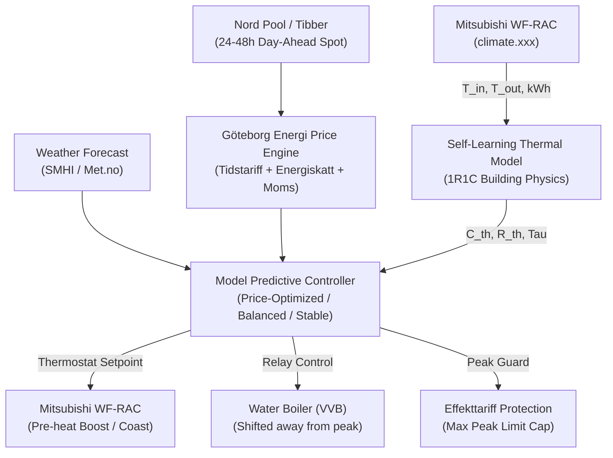

# Smart Energy & Mitsubishi WF-RAC Manager for Home Assistant (v2.0)

[](https://github.com/castmo/home-assistant-smart-energy/releases)
[](https://hacs.xyz)
[](https://www.home-assistant.io/)
[](LICENSE)

A complete, self-learning Home Energy Management System (HEMS) and Lovelace dashboard for Home Assistant, tailored specifically for the **Nordic / Swedish electricity model** (`Spotpris + Göteborg Energi Elnät + Energiskatt + Påslag + 25% Moms + Effekttariff`).

---

## 🌟 What's New in v2.0.0 (The UI & Thermal MPC Revolution)

In **v1.0**, managing energy required copying 500+ lines of YAML template sensors, configuring dozens of input helpers, and manually editing automations.

**v2.0.0** completely transforms the project into a **Native Home Assistant Custom Integration**:
* 🚀 **1-Minute UI Setup:** Configured entirely through the Home Assistant UI (**Settings -> Devices & Services -> Add Integration**). No YAML required!
* 🧠 **Self-Learning Building Physics (RLS):** Employs an Equivalent Thermal Parameter model (1R1C network) with online Recursive Least Squares to learn your house's unique thermal capacity ($C_{th}$), wall resistance ($R_{th}$), and time constant ($\tau$).
* ❄️ **Native Mitsubishi WF-RAC Auto-Discovery:** Seamlessly connects to your Mitsubishi heat pump. Automatically discovers indoor room temperature, outdoor temperature, and cumulative energy consumption directly from `climate.<device>`—**zero extra sensors required**!
* ⚡ **Göteborg Energi Tidstariff & Effekttariff Protection:** Pre-configured with official Gothenburg transmission fees (Winter Höglast/Låglast). Features anti-coincidence load staggering to prevent heat pump boosts and water boilers from creating expensive 10+ kW peaks.
* 📊 **Custom Lovelace Card (`smart-energy-optimizer-card.js`):** Beautiful interactive card showcasing live COP, action timeline (Boost / Normal / Eco), Göteborg Energi tariff badge, and big consumers.
* 📖 **Dedicated External Sensors Guide:** Step-by-step instructions for Nordpool, Tibber, Mitsubishi WF-RAC, and Göteborg Energi HAN/P1 meter readers.

---

## ⚡ Core Architecture



---

## 🚀 Installation

### Option 1: HACS (Recommended)
1. In Home Assistant, open **HACS** -> **Integrations**.
2. Click the top-right menu (three dots) -> **Custom repositories**.
3. Add repository URL:
   ```text
   https://github.com/castmo/home-assistant-smart-energy
   ```
   Category: **Integration**.
4. Click **Add**, then click **Download** (choose v2.0.0).
5. **Restart Home Assistant** (**Settings -> System -> Restart**).
6. **Hard refresh your browser** (`Ctrl + F5` or `Cmd + Shift + R`) to reload Home Assistant's integration cache.

### Option 2: Manual Installation
1. Download the latest `v2.0.0` release from [Releases](https://github.com/castmo/home-assistant-smart-energy/releases).
2. Copy `custom_components/smart_energy_optimizer/` into your Home Assistant `<config>/custom_components/` directory.
3. Copy `www/smart-energy-optimizer-card.js` into your Home Assistant `<config>/www/` directory.
4. **Restart Home Assistant** and **Hard refresh your browser** (`Ctrl + F5`).

---

## ⚙️ Adding the Integration

> ⚠️ **Important:** You must complete the installation steps above and restart Home Assistant before the integration will appear in the search!

1. In Home Assistant, go to **Settings** -> **Devices & Services** -> **Add Integration** button (bottom right).
2. Search for:
   ```text
   Smart Energy
   ```
   *(or search by domain: `smart_energy_optimizer`)*.
3. **Select only two entities:**
   - **Heat Pump Climate Entity:** Select your heat pump (e.g. `climate.living_room` from Mitsubishi WF-RAC).
   - **Electricity Spot Price Sensor:** Select your price sensor (e.g. `sensor.nordpool_kwh_se3_sek_3_10_025` or `sensor.electricity_price_home`).
   - *(Optional)* Weather entity defaults automatically to your Home Assistant forecast (`weather.forecast_home`).
4. Click **Submit**! Done!

> 💡 **Using Mitsubishi WF-RAC?** Indoor room temperature, outdoor temperature, and active energy consumption are all auto-detected automatically without needing any extra physical sensors!
>
> 💡 **Living in Gothenburg?** Official Göteborg Energi Tidstariff (Winter High/Low Load), 2026 Swedish energy tax (0.445 SEK/kWh), and 25% VAT are pre-configured automatically!

---

## 📖 External Sensors Guide

Confused about where to get spot prices, or what sensors are needed for your boiler or smart meter?
Check out our complete, step-by-step setup guide:
👉 **[External Sensors & Setup Guide](docs/EXTERNAL_SENSORS_GUIDE.md)**

* [1. Setting Up Spot Prices (Nordpool SE3 / Tibber)](docs/EXTERNAL_SENSORS_GUIDE.md#1-setting-up-the-electricity-spot-price-sensor)
* [2. Mitsubishi WF-RAC Built-In Sensors (Zero Hardware Needed)](docs/EXTERNAL_SENSORS_GUIDE.md#2-mitsubishi-wf-rac-heat-pump-built-in-sensors)
* [3. Weather Forecast Entity (SMHI / Met.no)](docs/EXTERNAL_SENSORS_GUIDE.md#3-weather-forecast-entity-outdoor-forecast)
* [4. Smart Water Boiler / Varmvattenberedare (Shelly Plus 1PM)](docs/EXTERNAL_SENSORS_GUIDE.md#4-water-boiler--varmvattenberedare-optional)
* [5. Göteborg Energi HAN/P1 Port Reader (Real-Time Villa Power)](docs/EXTERNAL_SENSORS_GUIDE.md#5-real-time-household-power--göteborg-energi-hanp1-port-optional)
* [6. Solar PV, Home Battery & EV Charger](docs/EXTERNAL_SENSORS_GUIDE.md#6-solar-pv-home-battery--ev-charger-optional)

---

## 📊 Dashboard & Lovelace Cards

### 1. Register the Custom Optimizer Card
Add the custom frontend card under **Settings** -> **Dashboards** -> **Resources** -> **Add Resource**:
* **URL:** `/local/smart-energy-optimizer-card.js`
* **Resource type:** `JavaScript Module`

### 2. Add the Dashboard
A complete ready-to-use Lovelace dashboard is provided in [`dashboards/smart_energy_dashboard.yaml`](dashboards/smart_energy_dashboard.yaml) featuring:
* Dedicated **Smart Energy Optimizer Card** with live COP, price tier badge, and 24h timeline.
* Real-time **Animated Energy Flow** (`power-flow-card-plus`).
* Effekttariff peak demand monitor and quick controls.

---

## 🧪 Testing

The thermal physics engine, recursive least squares estimator, and MPC optimizer include a comprehensive test suite:
```bash
python -m unittest tests/test_optimizer.py
```
*(All 9 unit tests pass in < 0.03 seconds with zero external C-dependencies).*

---

## 📄 License

Distributed under the MIT License. See [LICENSE](LICENSE) for details.
